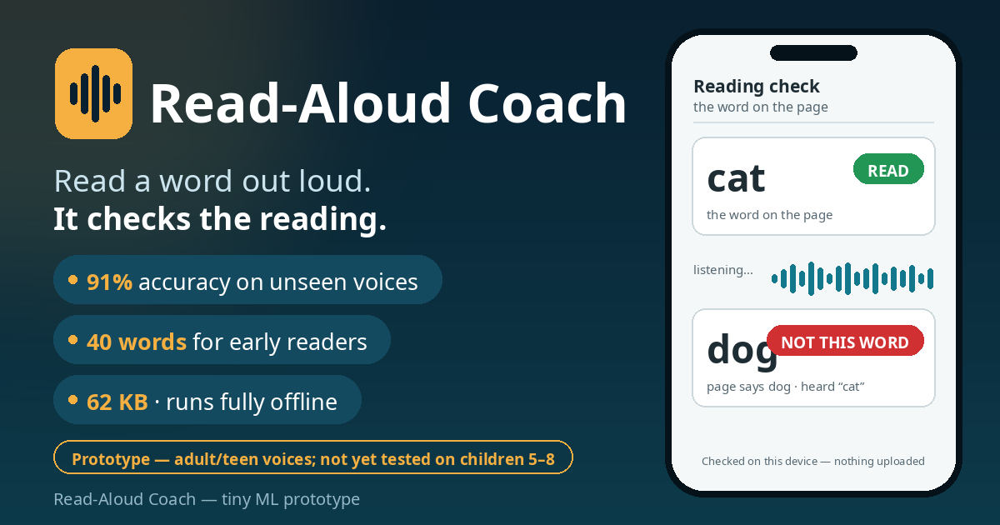

# Read-Aloud Coach — Tiny ML



A tiny known-page word verifier for early readers (62 KB, runs fully
offline): the child reads a word from a known page aloud, and the model
says whether that word was read correctly — **READ** vs **STUMBLED /
NOT THIS WORD**. One small ONNX model, no network, no account. Trained
only on public, license-verified data — no AI-generated labels, no
frontier-model output in the training data. See PROVENANCE.md.

> **Validation status: validated on adult/teen voices, NOT yet on
> children 5–8.** Every training and test voice is an adult (LibriSpeech)
> or adult/teen (Google Speech Commands). Accuracy on the actual target
> users — children aged 5–8 — is unproven. Treat this as a supervised
> prototype: verdicts are hints for a supervising adult, not grades.

## How the verifier works

- Input: a 1-second 16 kHz clip → 40-band log-mel spectrogram (40×63).
- Model: depthwise-separable CNN (42,586 parameters), 42 classes = the 40
  covered vocabulary words + `_other_` (any other word) + `_silence_`.
- Verifier (`predict.py`): the app supplies the **target word** from the
  page being read. The word is accepted — verdict READ — only if it
  passes a decision rule tuned on the validation split (never on test):

      accept word e  iff  p(e) ≥ 0.30  and  p(e) − max_{c ≠ e} p(c) ≥ 0.0

  If the model's top prediction is a different covered word, the verdict
  is NOT THIS WORD (with the word it heard); anything else is STUMBLED.
  The rule was chosen to maximise true-accepts subject to a ≤10%
  false-accept budget on validation — it landed far inside the budget
  (see table), at the cost of rejecting about 1 in 10 correctly read
  words.

## Results (held-out test, speaker-disjoint, evaluated once)

| Metric | v1 | v2 |
|---|---|---|
| Overall accuracy | 82.5% (6,012 clips) | **91.1%** (6,413 clips) |
| Vocabulary-word accuracy | 82.7% | **91.0%** |
| — Speech Commands clips | 83.0% | **91.8%** |
| — LibriSpeech clips | 65.1% | **83.7%** |
| False-accept, plain argmax (v1 definition) | 18.4% | **8.1%** |
| False-accept with the decision rule | — (no rule) | **0.18%** |
| True-accept with the decision rule | — | **90.2%** |
| Words covered (of a 50-word list) | 26 | **40** |
| Model size (int8 ONNX) | 60 KB | **62 KB** |

False-accept = a clip that is *not* the target word being accepted as
read correctly — the failure that matters most for a reading coach,
because it tells a child a wrong reading was right. On the plain
argmax definition v1 used (a non-word clip classified as some
vocabulary word), v2 cuts it from 18.4% to 8.1%; with the decision
rule applied, only 0.18% of `_other_`/`_silence_` clips (0.15% over
all wrong-word pairs) are falsely accepted. The int8 model scores
essentially the same as fp32 (91.1% → 90.9% overall). v2 was trained
on a Colab T4 GPU (16 epochs, ~72 s of GPU time, 0.14 compute units)
from frozen speaker-disjoint caches: 37,769 train / 6,046 validation /
6,413 test clips. Full per-word numbers: `metrics_v2.json` (v1:
`metrics.json`).

## Vocabulary

Target: a 50-word early-reader list (`vocab.py`). **Covered: 40 of 50.**

- From Google Speech Commands (isolated-word recordings), 16 words:
  bed, bird, cat, dog, down, go, happy, house, no, on, one, stop,
  three, tree, two, yes.
- From LibriSpeech (words cut from read-aloud sentences by forced
  alignment against the corpus's own human transcripts), 24 words:
  a, and, away, can, come, for, here, in, is, it, little, look, make,
  me, my, not, said, see, the, to, up, we, where, you.
- Not covered (fewer than the 40-clip minimum in the public corpora;
  dropped, never padded): big, blue, find, funny, help, jump, play,
  red, run, yellow.

## Honest limits

- **Not validated on children.** All voices are adult/teen. Training
  includes programmatic pitch-up augmentation toward child-like pitch,
  but that is not a substitute for real child speech, and no
  permissively licensed children's speech corpus exists publicly.
  Do not present these accuracy figures as child accuracy.
- **Supervised prototype only.** Even with the decision rule, ~9.8% of
  correctly read words are rejected (the child is told to try again
  when they were right), and a small share of wrong readings pass.
  An adult should supervise; the model must not grade.
- **Some per-word scores are nearly meaningless.** 13 covered words
  have fewer than 20 test clips. The weakest — a (14%, n=7), we (26%,
  n=19), can (33%, n=6), look (50%, n=4) — rest on a handful of clips
  and could move a lot with more data; several 100% scores sit on
  single-digit counts too.
- **Function words are intrinsically harder.** Words cut from
  continuous LibriSpeech sentences score 83.7% vs 91.8% for isolated
  Speech Commands words — short words like "a", "the", "to" blur into
  their neighbours in real reading.
- Test speakers are disjoint from training speakers, but all speech
  comes from two corpora recorded in quiet conditions; real
  classrooms, tablets, and background noise will differ.

## Data & provenance

- **Google Speech Commands v0.02** — CC BY 4.0. Isolated words;
  official speaker-hash splits.
- **LibriSpeech dev-clean + train-clean-100** (OpenSLR) — CC BY 4.0.
  Clips cut by CTC forced alignment (open-weight wav2vec2 used as a
  locating tool only) against LibriSpeech's own human transcripts.

No Muse or OpenAI/Luna output was used in data, labels, selection,
or filtering at any stage; augmentation is purely programmatic. Full
record: `PROVENANCE.md`.

## Files

- `predict.py` — the v2 verifier demo (loads `model_v2_int8.onnx`;
  class list and mel stats are read from `metrics_v2.json`)
- `metrics_v2.json` / `metrics.json` — full held-out metrics for
  v2 / v1, including per-word accuracy and the decision rule
- `train_v2.py` — v2 training script; `train_v2_gpu.py` — the GPU
  variant actually run on Colab; `finalize_v2.py` — one-shot rule
  tuning (validation only), single test evaluation, ONNX export
- `prep_sc.py`, `prep_ls.py`, `prep_ls_v2.py`, `prep_tc100_v2.py`,
  `merge_v2.py` — data preparation (dataset downloads, forced
  alignment, cache building)
- `train.py`, `export_eval.py` — the v1 pipeline
- `vocab.py` — the 50-word target vocabulary
- `PROVENANCE.md` — data sources, licenses, and method
- The v2 int8 model — `model_v2_int8.onnx` (62 KB) — **is in this
  repo** (root directory, next to `predict.py`). The fp32
  `model_v2.onnx` (171 KB) is not included; it is available on
  request.

## Run it (Python)

```bash
python3 predict.py <clip.wav> <expected_word>
```

Verified against the v2 int8 model on held-out Speech Commands test
clips:

```
$ python3 predict.py cat_test_clip.wav cat
predicted: cat (1.00)
expected 'cat' probability: 1.00
verdict: READ

$ python3 predict.py cat_test_clip.wav dog
predicted: cat (1.00)
expected 'dog' probability: 0.00
verdict: NOT THIS WORD (heard 'cat')
```
